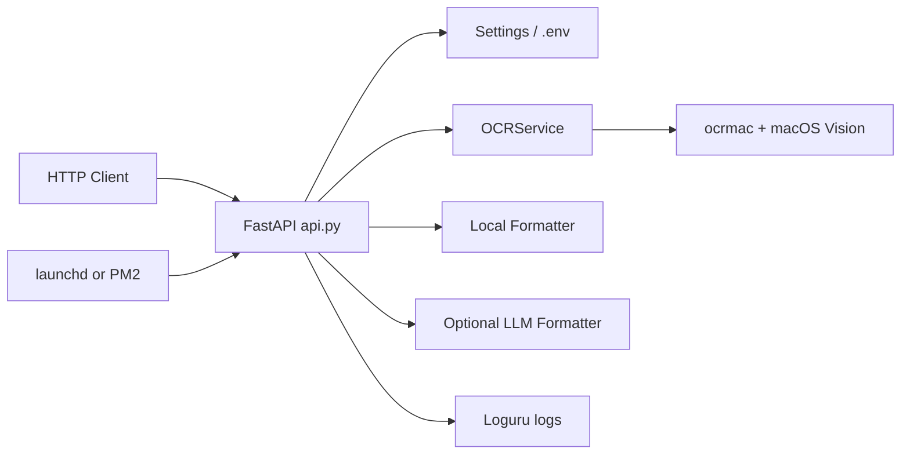

# OCR Mac API 需求、技术架构与运维清单

更新日期：2026-08-30。本文以当前 FastAPI、ocrmac/Vision 和启动脚本为准。

## 需求范围

- 通过 HTTP 接收图片并使用 macOS Vision/ocrmac 完成 OCR，支持健康检查与服务状态查询。
- 支持本地规则排版和可选 LLM 排版；没有 LLM 配置时 OCR 主流程仍应可用。
- 对请求大小、图片尺寸、超时、来源和认证 token 做配置约束；错误响应不得泄露本机路径或密钥。
- 支持 launchd 或 PM2 两种常驻方式，但同一实例只能选择一种进程管理器。

## 技术架构

`src/api.py` 负责协议、认证和校验；`ocr_service.py` 封装系统 OCR；formatter 模块只处理识别文本，避免把 transport 与模型调用耦合。

## 定时与自动执行清单

| 类型 | 定义 | 触发/策略 | 作用 |
| --- | --- | --- | --- |
| launchd | `setup_autostart.sh` 生成 LaunchAgent；仓库含旧模板 `com.ocrmac.api.plist` | `RunAtLoad=true`、`KeepAlive=true`、10 秒节流 | 登录后启动并在退出后重启 |
| PM2 | `ecosystem.config.cjs` | `autorestart=true` | 另一种进程常驻方式 |

未发现 cron、calendar schedule、systemd timer 或 GitHub Actions `schedule`。仓库内静态 plist 含旧机器绝对路径，不应直接安装；以 `setup_autostart.sh` 当前路径生成的 plist 为准。

## 敏感信息检查与整改

- 本机 `.env` 含认证 token/LLM API key 配置，已被 `.gitignore` 排除且未被 Git 跟踪。保持最小文件权限，若曾经复制到聊天、日志或历史提交，应立即轮换。
- `config.example.env` 只能保留空值或明显占位值；日志不得输出 `Authorization`、LLM key 或完整请求图片。
- 建议废弃或模板化仓库中的旧绝对路径 plist，避免运维人员误装到错误目录；生产只启用 launchd/PM2 之一。

## 验证基线

- 在项目虚拟环境执行 `python -m compileall main.py src`。
- 启动后调用 `/health`、认证失败、有效 OCR、超限图片和 LLM 不可用回退用例。
- 对实际安装的 LaunchAgent 运行 `plutil -lint` 并核对 `launchctl print gui/$(id -u)/com.ocrmac.api`。
